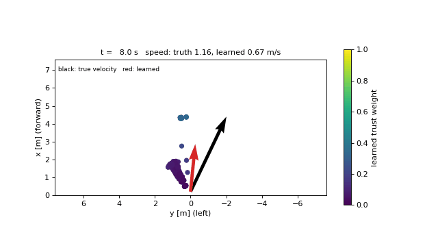
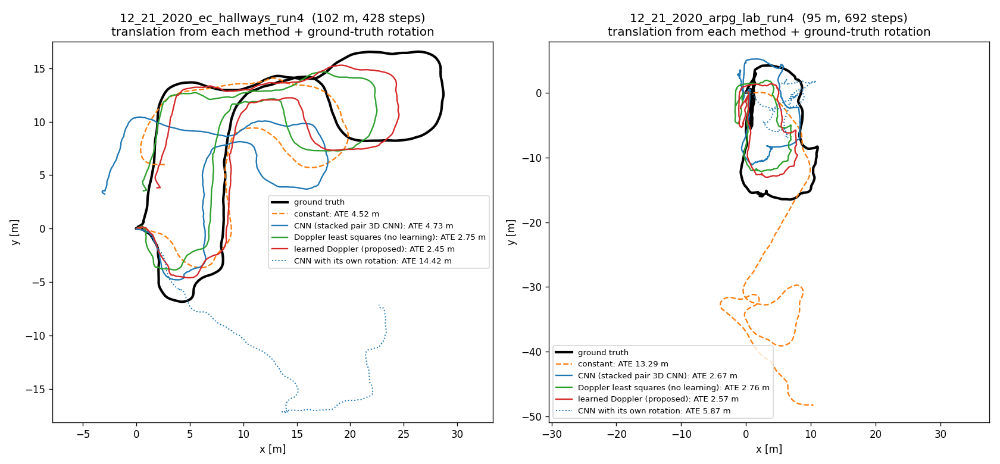
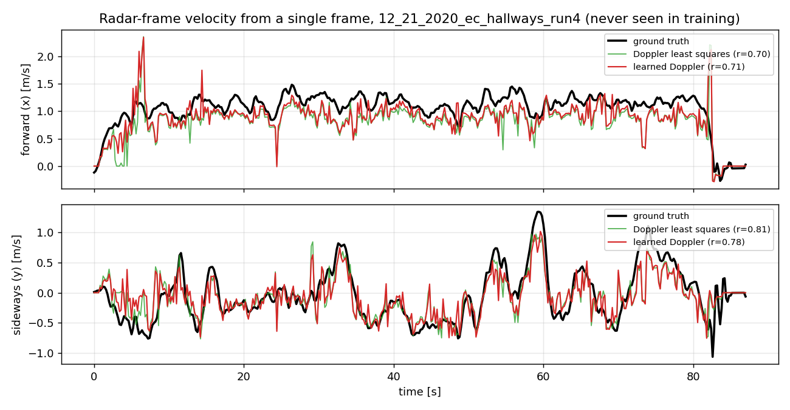
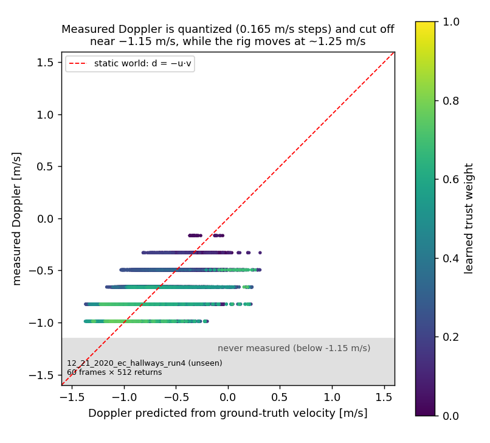
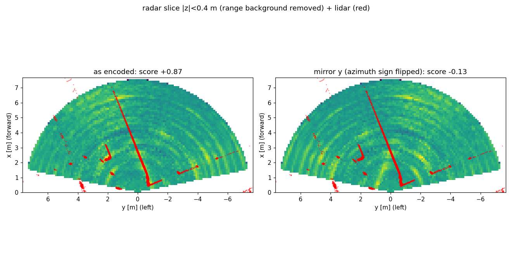

# Learned radar odometry: stacked-pair CNN vs learned Doppler

Radar odometry on the [ColoRadar](https://arpg.colorado.edu/coloradar/) cascade-radar
heatmaps. Two approaches are compared on runs never seen in training:

* a **stacked-pair 3D CNN** (after Kramer's scan-alignment network, 9.4M parameters): two
  polar heatmaps resampled to Cartesian voxels on the GPU, regressed to the 6-DoF pose change;
* a **learned Doppler velocity model** (proposed, 26k parameters): a PointNet weights each
  radar return, and velocity is the differentiable weighted least-squares solution of the
  Doppler equation d = −u·v, from a single frame.

**Result:** given the same (ground-truth) rotation, the learned Doppler model halves the
CNN's trajectory error on the hallway test run (2.45 m vs 4.73 m over 102 m) and beats it
in the lab (2.57 m vs 2.67 m). The CNN does not learn rotation at all, and cannot get it
from Doppler: for a static reflector the rotational term u·(ω×p) is zero.

<p align="center"></p>

| | |
|---|---|
|  |  |
| Unseen runs: each method's translation chained with ground-truth rotation | Single-frame velocity vs ground truth on an unseen run |
|  |  |
| Measured vs physics-predicted Doppler: quantized in 0.165 m/s steps and cut off near −1.15 m/s, while the rig moves at ~1.25 m/s (a ceiling for any Doppler method) | Geometry check: lidar (red) moved into the radar frame lines up with radar returns; best match at exactly 0° yaw |

Figures: `python scripts/make_figures.py --config configs/coloradar_4runs.yaml`.

This repository rewrites `asldoc-2022-RobotX-Nada-Learning-Radar-Odometry`, whose reported
accuracy came from a model no better than a constant guess. See
[What changed and why](#what-changed-and-why).

## Install

```bash
pip install -e ".[test]"
pytest
```

Python ≥ 3.9, PyTorch, NumPy, SciPy. No ROS needed.

## Layout

```
radar_odom/
  geometry.py        SE(3): relative poses, twists, composition, SLERP, Umeyama
  encoding.py        polar -> Cartesian trilinear resampling (grid_sample, real bin angles)
  model.py           stacked-pair 3D CNN
  train.py           training (split by sequence, early stopping on validation)
  evaluate.py        chained trajectories, RPE / ATE / drift vs zero & constant baselines
  data/
    store.py         processed sequence format (polar.npy, stamps.npy, poses.npy)
    sync.py          radar <-> ground-truth association by timestamp (interpolated)
    dataset.py       (k, k+s) pairs within a sequence, body-frame labels
    coloradar.py     reader for ColoRadar plain files
    synthetic.py     synthetic scenes with exact motion (pipeline check)
configs/             synthetic.yaml, coloradar.yaml
scripts/             make_synthetic.py, prepare_coloradar.py, check_coloradar.py
tests/               geometry, encoding, sync, dataset, model
```

## Quick start (synthetic, ~1 GB, minutes on a laptop GPU)

```bash
python scripts/make_synthetic.py --config configs/synthetic.yaml
python -m radar_odom.train --config configs/synthetic.yaml
python -m radar_odom.evaluate --run runs/synthetic
```

Synthetic data checks the pipeline end to end with exact ground truth. Its numbers say
nothing about accuracy on real radar.

## ColoRadar

1. Download sequences (one zip each) from the dataset page:
   <https://arpg.colorado.edu/coloradar/>, which links to the file share. Also get the
   `calib` folder. Skip the `longboard` runs (much faster motion than the rest).
2. Convert:
   ```bash
   python scripts/prepare_coloradar.py --raw /path/to/coloradar --calib /path/to/coloradar/calib \
       --out data/coloradar 12_21_2020_ec_hallways_run0 ...
   ```
3. **Check one sequence before converting everything:**
   ```bash
   python scripts/check_coloradar.py --config configs/coloradar.yaml --seq 12_21_2020_ec_hallways_run0 --frame 100
   ```
   Walls must look straight in the Cartesian top view. The reader in
   `radar_odom/data/coloradar.py` follows the paper (heatmap = elevation × azimuth ×
   range × [intensity, Doppler], float32) but file names and calib formats were written
   without the data at hand. Fix them there if the check fails.
4. Put the sequence names in `configs/coloradar.yaml` (split by sequence, ideally hold out
   whole runs of each environment for test), then train and evaluate as above.

### Synthetic run (pipeline check, not a radar result)

10 training / 2 validation / 2 test sequences of 300 frames, stride-1 evaluation
(`runs/synthetic/`). Best validation loss 0.18 against 0.99 for the constant predictor.

| test seq | method | RPE trans [m] | RPE rot [deg] | ATE RMSE [m] |
|---|---|---|---|---|
| seq_12 | model | 0.031 | 0.46 | 1.28 |
| seq_12 | constant | 0.054 | 1.75 | 2.98 |
| seq_13 | model | 0.060 | 0.79 | 4.19 |
| seq_13 | constant | 0.094 | 1.78 | 5.98 |

Per-step errors are well below the baselines, so the labels, pairing and encoding are
consistent. Chained trajectories still drift (37–58 % end-point drift), and the gap
between training (0.06) and validation loss shows overfitting with only 10 sequences.

### ColoRadar, first look (one run, not a result)

Geometry verified on `12_21_2020_ec_hallways_run0`: lidar scans moved into the radar
frame with the calib transforms line up best with the radar image at exactly 0° yaw
(`scripts/check_lidar_overlay.py`; score 0.68 vs −0.35 at 90°).

Training on time chunks of that single run (343 / 68 / 69 frames; `configs/coloradar_run0_chunks.yaml`):

| run | train loss | best val loss | constant (val) | test RPE trans / rot | constant |
|---|---|---|---|---|---|
| per-frame max scaling | 1.00 | 1.39 | 1.39 | 0.212 m / 5.95° | 0.158 m / 5.58° |
| noise floor removed (`runs/coloradar_run0_floor`) | 0.45 | 1.25 | 1.39 | 0.203 m / 5.86° | 0.158 m / 5.58° |

Removing the noise floor lets the network fit the training pairs, but it overfits 683
pairs and does not beat the constant predictor on the test chunk.

### ColoRadar, split by run (`configs/coloradar_4runs.yaml`)

Train: `ec_hallways_run0`, `arpg_lab_run0` (first 85 %; last 15 % = validation).
Test: `ec_hallways_run4`, `arpg_lab_run4`, never seen in training.

A least-squares fit of ego-velocity to the Doppler of the brightest 1 % of cells (no
learning) correlates 0.86–0.97 with ground-truth vx/vy on the test runs, so the motion
signal is in the data. The CNN only used it once Doppler was weighted by the
floor-removed intensity (Doppler is random in noise cells).

| test run | method | RPE trans [m] | RPE rot [deg] | ATE RMSE [m] |
|---|---|---|---|---|
| ec_hallways_run4 | model, raw Doppler | 0.233 | 3.65 | 11.1 |
| ec_hallways_run4 | **model, intensity-weighted Doppler** | **0.111** | 3.69 | 14.4 |
| ec_hallways_run4 | constant | 0.131 | 3.68 | 13.9 |
| ec_hallways_run4 | zero | 0.239 | 3.67 | 11.5 |
| arpg_lab_run4 | model, raw Doppler | 0.137 | 3.74 | 7.3 |
| arpg_lab_run4 | **model, intensity-weighted Doppler** | **0.088** | 4.05 | 5.9 |
| arpg_lab_run4 | constant | 0.167 | 3.74 | 16.9 |
| arpg_lab_run4 | zero | 0.138 | 3.74 | 8.1 |

Translation per step now beats both baselines on unseen runs (−15 % and −36 % vs
the better baseline). Rotation is not learned (≈ baselines), so heading errors build up
and chained trajectories drift (`runs/coloradar_4runs_dopmask/trajectories_test.png`).
Note: the test runs are loops, so "end drift" favours the zero predictor; use RPE/ATE.

## CNN vs learned Doppler (proposed)

`python scripts/compare_methods.py --config configs/coloradar_4runs.yaml --cnn runs/coloradar_4runs_dopmask --doppler runs/doppler_net`

**Why the stacked-pair CNN is the wrong tool here.** For a static reflector the radar
measures d = −u·v; the rotational term u·(ω×p) vanishes because p ∥ u
(`tests/test_doppler.py` checks this). The strongest motion cue in the data therefore
carries no rotation at all, so rotation must come from matching two coarse radar
volumes, which the CNN does not learn (rotation error = baselines). For translation, the
CNN must rediscover a linear physical law from 1.8k pairs with 9.4M parameters.

**Proposed: learned robust Doppler velocity** (`radar_odom/doppler.py`). Per frame, take
the 512 strongest returns as a point set (direction, range, Doppler, intensity). A small
PointNet scores each return's reliability (moving objects, multipath, noise), and the
velocity is the closed-form weighted least-squares solution of d = −u·v, in two rounds
(the second sees residuals: a learned IRLS). One frame, 26k parameters, physics built in.
Trained with yaw augmentation (rotating u and v together leaves Doppler unchanged).

Unseen test runs, translation per step and trajectories with **ground-truth rotation**
for every method (isolates translation; rotation must come from elsewhere, e.g. a gyro):

| test run | method | step error [cm] | ATE [m] | ATE [% path] |
|---|---|---|---|---|
| ec_hallways_run4 (102 m) | zero | 23.9 | 11.51 | 11.2 |
| | constant | 13.1 | 4.52 | 4.4 |
| | CNN | 11.1 | 4.73 | 4.6 |
| | Doppler least squares (no learning) | 8.8 | 2.75 | 2.7 |
| | **learned Doppler** | **8.5** | **2.45** | **2.4** |
| arpg_lab_run4 (95 m) | zero | 13.8 | 8.13 | 8.5 |
| | constant | 16.7 | 13.29 | 14.0 |
| | CNN | 8.7 | 2.67 | 2.8 |
| | Doppler least squares (no learning) | 7.5 | 2.76 | 2.9 |
| | **learned Doppler** | **7.2** | **2.57** | **2.7** |

Rotation per step: CNN 3.69° / 4.05° vs zero 3.67° / 3.74°. With its own rotation the
CNN's ATE is 14.4 m / 5.9 m.

Caveats: two test runs, one seed. The learned model beats plain least squares by only
3–4 % per step (the physics does most of the work); vertical motion (~4.3 cm/step of
the error for every method) is poorly observable because the radar resolves elevation
weakly. A full odometry system needs rotation from another source: a gyroscope
(ColoRadar includes an IMU) or a learned registration step.

## Reading results

`evaluate` writes `results_test.md`, `metrics_test.json`, `trajectories_test.png` and
`loss.png` into the run folder. Every metric is shown next to:

* **zero**: predicts no motion;
* **constant**: predicts the average training motion for every pair.

Unless the model clearly beats **constant**, it has not learned anything from the radar.
`train` prints the exact constant-predictor validation loss at the start for the same reason.

## What changed and why

| Old pipeline | Problem | Now |
|---|---|---|
| label `p2 - p1` (world frame), `q1·q2⁻¹` | depends on the absolute heading, which a sensor-frame image pair cannot see, so it can't be learned | `T_1_2 = T_w1⁻¹ T_w2`; test checks invariance to the world frame |
| all pairs `i<j` within 0.8 m | includes revisits, not odometry; each frame in dozens of pairs | `(k, k+s)` within one sequence, `s` in `data.strides` |
| random split over pairs | the same frames end up in train and validation | split by whole sequence, checked at start |
| training reshape `(2,64,128,64)` of a `(64,128,64,2)` array | input channels scrambled | channels kept explicit, Doppler used |
| Cartesian grid from 0 on every axis; angles mapped over 360°/180° | only one octant; wrong geometry | centred grid, real bin angles, out-of-FOV = 0; tests place points left/right/below |
| polar reshape `(N_r, N_a, N_e)` | ColoRadar stores `(N_e, N_a, N_r, 2)` | layout explicit (`--layout`) |
| pose file named by `list_b[i]`, paired by sorted index | poses can be attached to the wrong images | one array per sequence, interpolated at each heatmap time |
| trajectory = sum of 6-vectors | not a trajectory, even for ground truth | SE(3) composition, RPE/ATE/drift |
| loss counted twice, LR schedule driven by an `epoch` argument, early stop on train loss | misleading curves | fixed |
| text files per frame, Python triple loop | slow, huge | float16 `.npy` memmaps, encoding on GPU |
